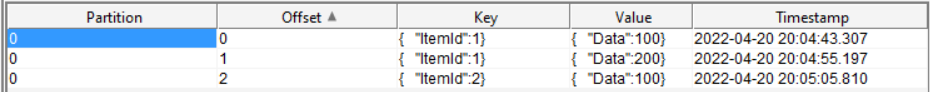

<p align="center">
  
</p>

# KafkaSnapshot

KafkaSnapshot is a .NET utility for exporting the current data snapshot from Apache Kafka topics to JSON files.

It is useful when you need to inspect topic state, capture data for diagnostics, export compacted views by key, or take a reproducible snapshot from a selected offset/date range.

## Highlights

- Export one or many Kafka topics to JSON files.
- Read multi-partition topics with optional concurrent loading.
- Compact messages by key to keep the latest value per key.
- Filter by key using equality, contains, greater-or-equal, and less-or-equal rules.
- Limit exported data by start/end timestamps or selected partition ids.
- Support JSON, string, long, and ignored keys.
- Decode string, MessagePack, MessagePack LZ4 block, and Base64 payloads.
- Stream unsorted, uncompacted snapshots from Kafka to JSON with bounded decoded-message buffering.
- Sort exported messages by timestamp or partition when compacting is disabled.
- Connect to secured clusters with SASL authentication.

## How It Works

KafkaSnapshot loads topic watermarks, reads matching messages from the selected partitions, applies optional filters/compacting/sorting, and writes the result to JSON.


## Requirements

- .NET 10 SDK
- Access to an Apache Kafka cluster

## Quick Start

The repository uses the modern `.slnx` solution format.

```powershell
dotnet restore src\KafkaSnapshot.slnx
dotnet build src\KafkaSnapshot.slnx --no-restore
dotnet test src\KafkaSnapshot.slnx --no-build
```

Configure the utility:

```powershell
notepad src\Utility\appsettings.json
```

Run it:

```powershell
dotnet run --project src\Utility\Utility.csproj
```

Exported files are written to the current working directory by default. Set `JsonFileDataExporterConfiguration.OutputDirectory` to write snapshots to a dedicated folder.

## Configuration

The main configuration file is [src/Utility/appsettings.json](src/Utility/appsettings.json). An optional JSON schema for editor completion and validation is available at [src/Utility/appsettings.schema.json](src/Utility/appsettings.schema.json).

A minimal configuration looks like this:

```json
{
  "BootstrapServersConfiguration": {
    "BootstrapServers": [ "kafka-test:9092" ]
  },
  "TopicWatermarkLoaderConfiguration": {
    "AdminClientTimeout": "00:00:05"
  },
  "SnapshotLoaderConfiguration": {
    "DateOffsetTimeout": "00:00:05",
    "SearchSinglePartition": false,
    "MaxConcurrentPartitions": 4
  },
  "JsonFileDataExporterConfiguration": {
    "UseFileStreaming": true,
    "OutputDirectory": "snapshots"
  },
  "LoaderToolConfiguration": {
    "UseConcurrentLoad": true,
    "GlobalMessageSort": "Time",
    "GlobalSortOrder": "Ascending",
    "Topics": [
      {
        "Name": "orders",
        "KeyType": "Json",
        "Compacting": "On",
        "ExportFileName": "orders.json"
      }
    ]
  }
}
```

## Common Recipes

### Export a Topic as Raw Strings

Use this when messages are plain strings and should not be formatted as JSON objects.

```json
{
  "Name": "events.raw",
  "KeyType": "String",
  "Compacting": "Off",
  "ExportRawMessage": true,
  "ExportFileName": "events.raw.json"
}
```

### Export Only Selected Partitions

```json
{
  "Name": "orders",
  "KeyType": "Json",
  "Compacting": "Off",
  "PartitionsIds": [ 0, 2 ],
  "ExportFileName": "orders.partitions-0-2.json"
}
```

### Export a Date Range

Use ISO 8601 values with an explicit UTC designator or offset.

```json
{
  "Name": "orders",
  "KeyType": "Json",
  "Compacting": "Off",
  "OffsetStartDate": "2021-09-01T12:12:12Z",
  "OffsetEndDate": "2021-09-01T14:12:12+02:00",
  "ExportFileName": "orders.range.json"
}
```

### Filter by Key

```json
{
  "Name": "users",
  "KeyType": "Long",
  "Compacting": "Off",
  "FilterKeyType": "GreaterOrEquals",
  "FilterKeyValue": 1000,
  "ExportFileName": "users.filtered.json"
}
```

Filter restrictions:

- `Contains` can be used only with string keys.
- `GreaterOrEquals` and `LessOrEquals` can be used only with long keys.
- `Compacting` is not supported when `KeyType` is `Ignored`.

### Decode MessagePack or Base64 Payloads

```json
{
  "Name": "packed-events",
  "KeyType": "Long",
  "MessageEncoderRule": "MessagePack",
  "ExportFileName": "packed-events.json"
}
```

Supported `MessageEncoderRule` values:

- `String`
- `MessagePack`
- `MessagePackLz4Block`
- `Base64`

## Full Example

```json
{
  "BootstrapServersConfiguration": {
    "BootstrapServers": [ "test" ],
    "Username": "user123",
    "Password": "pwd123",
    "SecurityProtocol": "SaslPlaintext",
    "SASLMechanism": "ScramSha512"
  },
  "TopicWatermarkLoaderConfiguration": {
    "AdminClientTimeout": "00:00:05"
  },
  "SnapshotLoaderConfiguration": {
    "DateOffsetTimeout": "00:00:05",
    "SearchSinglePartition": false,
    "MaxConcurrentPartitions": 4
  },
  "JsonFileDataExporterConfiguration": {
    "UseFileStreaming": true,
    "OutputDirectory": "snapshots"
  },
  "LoaderToolConfiguration": {
    "UseConcurrentLoad": true,
    "GlobalMessageSort": "Time",
    "GlobalSortOrder": "Ascending",
    "Topics": [
      {
        "Name": "topic1",
        "KeyType": "Json",
        "Compacting": "On",
        "ExportFileName": "topic1.json",
        "FilterKeyType": "Equals",
        "FilterKeyValue": "{\"value\": 1 }",
        "OffsetStartDate": "2021-09-01T12:12:12Z",
        "OffsetEndDate": "2021-09-01T14:12:12+02:00",
        "ExportRawMessage": true,
        "PartitionsIds": [ 0, 2 ]
      },
      {
        "Name": "topic2",
        "KeyType": "String",
        "Compacting": "Off",
        "ExportFileName": "topic2.json"
      },
      {
        "Name": "topic3",
        "KeyType": "Long",
        "Compacting": "Off",
        "ExportFileName": "topic3.json",
        "FilterKeyType": "Equals",
        "FilterKeyValue": 42
      },
      {
        "Name": "topic4",
        "KeyType": "Ignored",
        "Compacting": "Off",
        "ExportFileName": "topic4.json"
      },
      {
        "Name": "topic5",
        "KeyType": "String",
        "Compacting": "Off",
        "FilterKeyType": "Contains",
        "FilterKeyValue": "Test",
        "ExportRawMessage": true,
        "ExportFileName": "topic5.json"
      },
      {
        "Name": "topic6",
        "KeyType": "Long",
        "Compacting": "Off",
        "FilterKeyType": "LessOrEquals",
        "FilterKeyValue": 3,
        "ExportFileName": "topic6.json"
      },
      {
        "Name": "topic7",
        "KeyType": "Long",
        "Compacting": "Off",
        "FilterKeyType": "GreaterOrEquals",
        "FilterKeyValue": 3,
        "ExportFileName": "topic7.json"
      },
      {
        "Name": "topic8",
        "KeyType": "Long",
        "ExportFileName": "topic8.json",
        "MessageEncoderRule": "MessagePack"
      },
      {
        "Name": "topic9",
        "KeyType": "Long",
        "ExportFileName": "topic9.json",
        "MessageEncoderRule": "MessagePackLz4Block"
      },
      {
        "Name": "topic10",
        "KeyType": "Long",
        "ExportRawMessage": true,
        "MessageEncoderRule": "Base64",
        "ExportFileName": "topic10.json"
      }
    ]
  }
}
```

## Configuration Reference

| Parameter | Description |
| --- | --- |
| `BootstrapServers` | Kafka bootstrap servers, for example `kafka-test:9092`. |
| `Username` | SASL username. Optional. |
| `Password` | SASL password. Optional. |
| `SecurityProtocol` | Broker communication protocol: `Plaintext`, `Ssl`, `SaslPlaintext`, or `SaslSsl`. Optional. |
| `SASLMechanism` | SASL mechanism: `Gssapi`, `Plain`, `ScramSha256`, `ScramSha512`, or `OAuthBearer`. Optional. |
| `AdminClientTimeout` | Timeout for loading cluster metadata. |
| `DateOffsetTimeout` | Timeout for finding Kafka offsets by timestamp. |
| `SearchSinglePartition` | Stops partition traversal after the first partition with suitable data. |
| `MaxConcurrentPartitions` | Maximum concurrent partitions for buffered loading. Optional; when omitted, all partitions are processed concurrently. Streaming traverses partitions sequentially. |
| `StreamBufferCapacity` | Maximum decoded messages queued by the streaming reader. Defaults to 256. Must be positive. |
| `UseFileStreaming` | Uses async streaming from Kafka to JSON when sorting and compaction are disabled. Sorting and compaction retain buffered loading. |
| `OutputDirectory` | Directory for exported files. Optional; when omitted, files are written to the current working directory. |
| `UseConcurrentLoad` | Loads configured topics concurrently instead of one by one. |
| `GlobalMessageSort` | Message metadata field used for sorting: `Time` or `Partition`. Optional. Applies only to topics without compacting. |
| `GlobalSortOrder` | Sort order: `Ascending`, `Descending`, or `None`. Legacy aliases `Ask`, `Desk`, and `No` are also supported. Applies only to topics without compacting. |
| `Name` | Kafka topic name. |
| `KeyType` | Kafka key representation: `Json`, `String`, `Long`, or `Ignored`. |
| `Compacting` | Enables or disables compacting by key: `On` or `Off`. Not supported for `Ignored` keys. |
| `ExportFileName` | Output JSON file name for the topic. |
| `FilterKeyType` | Key filter type: `None`, `Equals`, `Contains`, `GreaterOrEquals`, or `LessOrEquals`. Optional. |
| `FilterKeyValue` | Value used by the selected key filter. |
| `OffsetStartDate` | First message timestamp to include. Use ISO 8601 with an explicit offset, for example `2021-09-01T12:12:12Z` or `2021-09-01T14:12:12+02:00`. Optional. |
| `OffsetEndDate` | Upper timestamp limit. Use ISO 8601 with an explicit offset, for example `2021-09-01T12:12:12Z` or `2021-09-01T14:12:12+02:00`. Optional. |
| `ExportRawMessage` | Exports message values as raw strings instead of formatting them as JSON. Optional. |
| `PartitionsIds` | Partition id filter. Optional. |
| `MessageEncoderRule` | Message body decoder. Defaults to `String`; also supports `MessagePack`, `MessagePackLz4Block`, and `Base64`. |

## Export Format

By default, KafkaSnapshot expects message values to contain JSON data. Simple strings are supported when `ExportRawMessage` is enabled.



```json
[
  {
    "Key": {
      "ItemId": 1
    },
    "Value": {
      "Data": 100
    },
    "Meta": {
      "Timestamp": "2022-04-20T17:04:43.307Z",
      "Partition": 0,
      "Offset": 0
    }
  },
  {
    "Key": {
      "ItemId": 1
    },
    "Value": {
      "Data": 200
    },
    "Meta": {
      "Timestamp": "2022-04-20T17:04:55.197Z",
      "Partition": 0,
      "Offset": 1
    }
  },
  {
    "Key": {
      "ItemId": 2
    },
    "Value": {
      "Data": 100
    },
    "Meta": {
      "Timestamp": "2022-04-20T17:05:05.81Z",
      "Partition": 0,
      "Offset": 2
    }
  }
]
```

| Field | Description |
| --- | --- |
| `Key` | Kafka message key. Optional when `KeyType` is `Ignored`. |
| `Value` | Kafka message value. |
| `Meta` | Kafka message metadata. |
| `Meta.Timestamp` | Kafka message creation timestamp. |
| `Meta.Partition` | Kafka partition id. |
| `Meta.Offset` | Kafka partition offset. |

## Notes for Existing Users

Recent versions use `DateTimeOffset` for date-based offsets and exported metadata timestamps.

- `OffsetStartDate` and `OffsetEndDate` should be configured as ISO 8601 strings with an explicit UTC designator or offset.
- `KafkaMetadata.Timestamp` is now a `DateTimeOffset`.
- `DateFilterRange.StartDate`, `DateFilterRange.EndDate`, `LoadingTopic.OffsetDate`, `LoadingTopic.EndOffsetDate`, `TopicConfiguration.OffsetStartDate`, and `TopicConfiguration.OffsetEndDate` are now `DateTimeOffset` values.
- `PartitionWatermark.TopicName` was renamed to `PartitionWatermark.Topic` because it stores the full loading topic configuration, not only the topic name.

## Tests and Coverage

Install the .NET SDK version pinned in `global.json` and PowerShell 7, then run from the repository root:

```powershell
./eng/Test.ps1
```

The script restores the pinned ReportGenerator tool, runs all seven test projects in Release mode with NuGet auditing enabled, merges coverage, and checks exact covered/total counts. It requires **100% line, branch, and method coverage** across the production assemblies. Each run writes TRX, OpenCover, Cobertura, and HTML reports under its own `artifacts/test-results/<run-id>/` directory; the final console output links to `report/index.html`. Old results are never included in a new run.

For a faster run without collecting coverage:

```powershell
dotnet test src/KafkaSnapshot.slnx --configuration Release
```

GitHub Actions runs the same coverage script on pushes (including merges into `main`), pull requests, and manual dispatch. The `windows-2025` runner installs the SDK pinned in `global.json`, publishes a coverage summary, and retains test results and the HTML report as the `test-results-and-coverage` artifact for 14 days. To require this check before merging, select `.NET 10 tests and 100% coverage` in the repository's branch protection settings.

### Coverage audit (2026-11-13)

Both measurements below use the updated dependencies, Coverlet 10.1.0, Release builds, and merged OpenCover reports. The baseline contains the original tests; no production code or executable source files were excluded to reach the final result.

| Metric | Before | After |
| --- | --- | --- |
| Passing test cases | 390 | 452 |
| Covered lines | 1,304 / 1,361 (95.8%) | 1,361 / 1,361 (100%) |
| Covered branches | 297 / 323 (91.9%) | 323 / 323 (100%) |
| Covered methods | 256 / 260 (98.4%) | 260 / 260 (100%) |

The additional tests cover invalid security and enum settings, metadata failures and client cleanup, cancellation and background service shutdown, JSON `null` payloads, topic name boundaries, rejected messages, compaction logging, and stable sorting within partitions. Existing validation tests now assert specific error codes; ambiguous method names and display names were clarified, including previously reversed date accessor test names and a null-stream test that previously failed on null data first.

The seven executable production assemblies are Export, Filters, Import, Models, Processing, Sorting, and Utility. Abstractions contains interfaces with no executable code. Integration tests exercise the full pipeline with fake Kafka clients, command-line startup validation, and native Kafka client creation/disposal. The default suite does not require a broker. Optional real-broker tests exercise snapshot boundaries and payload semantics; secured-cluster authentication remains outside the suite.

## Architecture and Snapshot Semantics

`Models` owns validated domain state. Models expose read-only properties; partition
selections are validated and copied into frozen sets by `PartitionSelection`. `ProcessingTopic` composes loading, export,
and key-filter models. `KeyFilterDefinition` validates filter compatibility and
sample types. Configuration validation reuses domain compatibility rules and keeps
stable `KS_CFG_*` diagnostics for startup errors. Name validation exposes domain
failure categories for the configuration adapter; file names, date ranges, partition
selections, sorting, and required filter values are checked through model creation.
The configuration validator retains section/enum binding checks and duplicate output
checks. Filter value conversion is shared with the mapper, and the untyped value is
validated before conversion to `TKey`, so a missing long filter cannot become zero.

`SnapshotLoader` coordinates metadata, partition reading, and `ISnapshotBuilder`.
The batch reader owns selection and concurrency settings. `TopicWatermarkLoader`
creates its metadata consumer through `IKafkaClientFactory`. Kafka assignment and
timestamp lookup belong to `IPartitionConsumerAssignment`, rather than watermark
models. `PartitionWatermark` now lives in `Models.Import`, with an `int` partition
and an `OffsetRange` instead of Kafka SDK values. `OffsetRange` owns the inclusive
low/exclusive high boundaries, emptiness, membership, and reading completion rules.
Negative or reversed intervals are rejected; equal boundaries represent an empty
snapshot. `KafkaWatermarkMapper` converts broker values at the Import boundary. `IExportFileStorage` owns output paths, directory creation, and file I/O;
exporters own serialization and dispose the returned streams.

With `UseFileStreaming: true`, `ProcessingUnit` connects `StreamSnapshotAsync` to
async export. Without sorting or compaction, one worker reads partitions in capture
order into a bounded channel. `StreamBufferCapacity` limits queued decoded messages;
one additional message can be waiting to enter the channel. The current serializer
item and the Kafka client's native prefetch buffers are additional memory. Streaming
uses one partition reader at a time, including in first-match mode; the existing
parallel buffered path continues to use `MaxConcurrentPartitions`.

Sorting or compaction selects the buffered snapshot path, then streams its JSON
representation. `UseFileStreaming: false` preserves buffered loading and string-based
file export. New streaming interfaces coexist with the existing synchronous-input
methods; the JSON file shape is unchanged.

The application preserves these snapshot rules:

- Capture partition watermarks before reading and assign the captured low offset
  explicitly. Group committed offsets do not select the start of a snapshot.
- Read only `[low, high)` offsets. Later appends cannot extend the captured range.
  Empty ranges do not create consumers. Partition EOF completes sparse intervals
  and transaction-control tails even when no data record exists at `high - 1`.
  EOF below the captured high reports a truncated snapshot instead of waiting.
- Data deleted by retention after capture cannot be reconstructed. Remaining
  records in the captured range are exported; deleting the whole range completes
  with no records. Watermarks do not provide a transactionally consistent backup.
- End timestamps are inclusive. The first message later than the end timestamp
  stops that partition, even if a later offset has an earlier timestamp. This is
  preserved behavior, not an exhaustive timestamp predicate over the whole log.
- Compaction keeps the last enumerated message per key. Within a partition this
  follows offset order; across partitions it follows capture traversal order,
  rather than comparing timestamps or unrelated offsets.
- Null payloads, including tombstones, remain explicit decoding errors. Ignored
  keys remain supported. First-match partition selection is applied after filters.
- The output file is opened only after the first read succeeds (or confirms an
  empty snapshot). Metadata failures or cancellation before that point preserve
  the previous file. Failure to open the output disposes the primed source.
- A buffered partition or concurrent-topic failure cancels sibling work and waits
  for its cleanup before propagating the failure; queued work is not started.
- Timestamp lookup cannot move reading below the captured low offset or extend
  it beyond the captured high offset.
- Cancellation, output errors, and early enumeration disposal cancel the producer
  and join its worker before returning. Every reader closes/disposes its consumer.
  As with the previous file-stream serializer, a failed export may leave a partial
  output file; atomic file replacement is not part of this change.

EOF and explicit assignment follow the [Confluent consumer API](https://docs.confluent.io/platform/current/clients/confluent-kafka-dotnet/_site/api/Confluent.Kafka.IConsumer-2.html)
and [consumer configuration](https://docs.confluent.io/platform/current/clients/confluent-kafka-dotnet/_site/api/Confluent.Kafka.ConsumerConfig.html).

### Real Kafka Tests

```powershell
./eng/Test-Kafka.ps1
```

This starts a uniquely named, pinned Apache Kafka 4.4.0 Docker container, runs six
broker tests, and removes the container in `finally`. Tests create/delete unique
topics. A Kafka metadata request verifies readiness before tests start; log messages
alone do not determine readiness. `-ReadinessTimeoutSeconds` defaults to 60.
Readiness output, TRX, container logs, and container inspection are retained under
`artifacts/broker-results/<run-id>/`, including after failures. External clusters
have no owned container to inspect or remove. The broker script rejects skipped
or empty test runs. Both test scripts terminate a test host after a three-minute
per-test hang timeout and retain diagnostic dumps with the test results.
Tests use event-driven synchronization with 30-second waits and a two-minute
scenario cancellation deadline; individual native Kafka calls have bounded timeouts.
Use `-Port 19093` if 19092 is occupied, or
`-BootstrapServers 127.0.0.1:9092` to use an existing disposable test cluster.
Do not point these tests at a production cluster. With no bootstrap environment
variable, the default suite explicitly skips the six broker tests. GitHub Actions
runs them in a separate `ubuntu-24.04`/Docker job using the same pinned SDK.

The broker suite checks transaction-control gaps, empty partitions, growth after
capture, retention deletion, non-monotonic timestamps, and rejected tombstones.
Deterministic tests additionally cover bounded backpressure, blocked-read
cancellation, early disposal, producer/output failures, byte-equivalent JSON shape,
first-match selection, and buffering decisions for sorting/compaction.

### Streaming Measurements (2026-11-13)

```powershell
# Existing test broker:
./eng/Measure.ps1 -BootstrapServers 127.0.0.1:19092
# Or provision the broker, run its tests and measure in one invocation:
./eng/Test-Kafka.ps1 -Measure
```

Measurements were taken on commit `b78719e`. Medians of three Release runs per mode,
each in a new process: Windows build 26200,
.NET 10.0.9, local Docker Kafka 4.4.0, one partition, 1,010-byte values, channel
capacity 64. Both modes stream JSON to disk; the baseline buffers Kafka messages
first. Timing includes metadata/loading/export and excludes seeding and output
verification. Managed heap is sampled every 10 ms; process peak working set also
includes native memory. First write means the first output-stream write call, not
stable storage or `fsync`.

| Messages | Mode | Peak managed MiB | Peak process MiB | First write ms | Total ms |
| --- | --- | ---: | ---: | ---: | ---: |
| 50,000 | buffered | 111.2 | 191.3 | 1327 | 1709 |
| 50,000 | streaming | 6.2 | 70.5 | 544 | 1312 |
| 200,000 | buffered | 431.0 | 572.3 | 2784 | 3981 |
| 200,000 | streaming | 6.7 | 69.0 | 441 | 2988 |

Every output was read back to verify contiguous offsets and the exact seeded count;
SHA-256 matched between modes and trials for each dataset. At four times the input,
streaming managed memory stayed near 6–7 MiB while the buffered path grew roughly
fourfold. This measures local single-partition behavior; it does not establish
multi-partition or remote-cluster throughput. Raw measurements and methodology are
in [results-2026-11-13.json](eng/Measurements/results-2026-11-13.json).

### Public API Migration

This branch changes source-level library contracts; the CLI configuration and JSON
export shape remain compatible. Callers implementing interfaces must account for
these changes:

- `IDataExporter` and `JsonFileDataExporter` now have three type parameters; pass
  `ExportedTopic` directly rather than supplying `TTopic`.
- `IExportFileStorage` replaces `IFileSaver` and `IFileStreamProvider`.
- `ISnapshotBuilder` / `SnapshotBuilder` replace the compactor names.
- `PartitionWatermark` is in `Models.Import`, with `int Partition` and an
  `OffsetRange`; Kafka values are converted by `KafkaWatermarkMapper`.
- Snapshot loaders, exporters and serializers expose async-stream methods;
  sorters expose `IsEnabled`, and snapshot builders expose `RequiresBuffering`.
- `ITopicWatermarkLoader` owns consumer creation rather than accepting a factory
  delegate from the caller. Reader assignment is injected through
  `IPartitionConsumerAssignment`.
- Domain state properties are read-only. Replace property assignment / `with`
  mutation with construction of a validated model.
