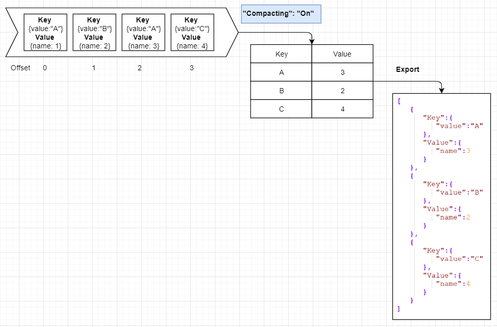

<p align="center">
  
</p>

# KafkaSnapshot

KafkaSnapshot is a .NET utility for exporting the current data snapshot from Apache Kafka topics to JSON files.

It is useful when you need to inspect topic state, capture data for diagnostics, export compacted views by key, or take a reproducible snapshot from a selected offset/date range.

## Highlights

- Export one or many Kafka topics to JSON files.
- Read multiple topics and partitions, with separate concurrency controls.
- Optionally stop after the first partition containing matching records.
- Compact messages by key to keep the latest value per key.
- Filter by key using equality, contains, greater-or-equal, and less-or-equal rules.
- Limit exported data by start/end timestamps or selected partition ids.
- Support JSON, string, long, and ignored keys.
- Decode UTF-8 or MessagePack values, including MessagePack LZ4 block compression.
- Represent binary message values as Base64 strings.
- Stream unsorted, uncompacted snapshots from Kafka to JSON with bounded decoded-message buffering.
- Sort exported messages by timestamp or partition when compacting is disabled.
- Connect to secured clusters with SASL authentication.

## How It Works

KafkaSnapshot loads topic watermarks, reads matching messages from the selected partitions, applies optional filters/compacting/sorting, and writes the result to JSON.



## Requirements

- To build or run from source: a stable **.NET 10 SDK** on x64. `global.json`
  selects the latest installed stable 10.0 SDK; an exact patch or feature band
  is not required.
- To run a framework-dependent published build: the x64 .NET 10 runtime.
- Access to the Kafka topics to export, including metadata and read permissions.
- PowerShell 7 for the scripts in `eng`; Docker with Linux containers for the
  provisioned broker tests. Neither is required for the application itself.

## Quick Start

Run these commands from the repository root. The solution uses the `.slnx` format.
The default test run does not need a Kafka broker.

```powershell
dotnet restore src/KafkaSnapshot.slnx
dotnet build src/KafkaSnapshot.slnx --configuration Release --no-restore
dotnet test src/KafkaSnapshot.slnx --configuration Release --no-build
```

Edit [src/Utility/appsettings.json](src/Utility/appsettings.json) for your cluster,
using the minimal configuration below if appropriate. The checked-in file contains
sample servers, credentials, and topic names that must be replaced.

Run **from the utility directory** so its configuration is loaded:

```powershell
cd src/Utility
dotnet run --configuration Release --no-build
# After the export finishes, return to the repository root:
cd ../..
```

The application exports one snapshot per configured topic and then exits. It does
not tail new records indefinitely. Ctrl+C requests cancellation and consumer cleanup.

Relative output paths are resolved from the process's working directory. In the
example above, `OutputDirectory: "snapshots"` writes to `src/Utility/snapshots`.
Without `OutputDirectory`, files are written directly to the working directory.
Existing files are overwritten; failure after writing starts can leave a partial file.

### Publish and Run Without the SDK

From the repository root:

```powershell
dotnet publish src/Utility/Utility.csproj --configuration Release --self-contained false --output artifacts/publish
cd artifacts/publish
# Configure the copied appsettings.json for your cluster before running:
dotnet KafkaSnapshot.Utility.dll
cd ../..
```

This publishes a framework-dependent build and copies the configuration files.
The target machine needs the x64 .NET 10 runtime and the Kafka client's native
runtime dependencies for its operating system.

## Configuration

The main configuration file is [src/Utility/appsettings.json](src/Utility/appsettings.json).
An optional [JSON schema](src/Utility/appsettings.schema.json) provides editor completion
and basic validation; the application's startup validators also enforce rules
across fields.

This minimal example exports UTF-8 message values as JSON strings, using bounded
streaming. `Compacting: "Off"` and `GlobalSortOrder: "None"` are intentional:

```json
{
  "BootstrapServersConfiguration": {
    "BootstrapServers": [
      "localhost:9092"
    ]
  },
  "TopicWatermarkLoaderConfiguration": {
    "AdminClientTimeout": "00:00:05"
  },
  "SnapshotLoaderConfiguration": {
    "DateOffsetTimeout": "00:00:05",
    "StreamBufferCapacity": 256
  },
  "JsonFileDataExporterConfiguration": {
    "UseFileStreaming": true,
    "OutputDirectory": "snapshots"
  },
  "LoaderToolConfiguration": {
    "GlobalSortOrder": "None",
    "Topics": [
      {
        "Name": "orders",
        "KeyType": "String",
        "Compacting": "Off",
        "ExportRawMessage": true,
        "ExportFileName": "orders.json"
      }
    ]
  }
}
```

### Configuration Sources and Overrides

The .NET Generic Host reads `appsettings.json` and the optional
`appsettings.{Environment}.json` from its content root, which defaults to the
working directory. Environment variables override JSON settings; command-line
arguments override both. Merely passing `--project src/Utility/Utility.csproj`
from the repository root does not select that folder as the configuration root.

Use `__` between configuration levels in environment variables:

```powershell
$env:JsonFileDataExporterConfiguration__OutputDirectory = "snapshots-dev"
```

Pass application arguments after `--`. For example, from `src/Utility`:

```powershell
dotnet run --configuration Release --no-build -- `
  --LoaderToolConfiguration:UseConcurrentLoad=true `
  --SnapshotLoaderConfiguration:MaxConcurrentPartitions=2
```

For SASL credentials, the same convention applies to
`BootstrapServersConfiguration__Username` and
`BootstrapServersConfiguration__Password`. Set a SASL security protocol and
mechanism along with those credentials. The repository example configures Serilog
console and daily rolling file sinks; change the `Serilog` section to adjust logging.

### Startup Validation

Configuration is validated before Kafka loading begins. Typical validation errors
include a stable `KS_CFG_*` code; conversion errors during configuration binding
can also be reported directly. Check the error and the relevant section when:

- Bootstrap servers or the topic list are missing or empty.
- `AdminClientTimeout`, `DateOffsetTimeout`, or `StreamBufferCapacity` is not positive,
  or a specified `MaxConcurrentPartitions` is not positive.
- A topic name is blank, longer than 249 characters, or contains characters outside
  ASCII letters, digits, `.`, `_`, and `-`.
- Export names are blank or repeated across topics. Name comparisons are case-insensitive.
- A date range is reversed, a partition id is negative, or an explicit partition
  selection is empty. Omit `PartitionsIds` or use `null` to select all partitions.
- A key filter and key type are incompatible, its sample is missing/invalid, or
  compaction is enabled for ignored keys.
- SASL settings are incomplete or are combined with a non-SASL security protocol.

`FilterKeyValue` is a string setting, including for numeric keys: use `"1000"`,
not a JSON number, to match both the schema and the configuration model.

## Common Recipes

Unless a full section is shown, the following JSON objects are individual entries
in `LoaderToolConfiguration.Topics`.

### Export Plain Text Values

`ExportRawMessage: true` writes the decoded value as a JSON string. The file still
contains a JSON array with message metadata; it is not plain text or NDJSON.

```json
{
  "Name": "events.raw",
  "KeyType": "String",
  "Compacting": "Off",
  "ExportRawMessage": true,
  "ExportFileName": "events.raw.json"
}
```

### Export Only Selected Partitions

```json
{
  "Name": "orders",
  "KeyType": "Json",
  "Compacting": "Off",
  "PartitionsIds": [0, 2],
  "ExportFileName": "orders.partitions-0-2.json"
}
```

### Export a Date Range

Use ISO 8601 values with an explicit UTC designator or offset. Start dates are
resolved to Kafka offsets; the end date is inclusive. These are offset traversal
rules, so out-of-order timestamps are not an exhaustive per-message date filter
(see [Snapshot semantics](#architecture-and-snapshot-semantics)).

```json
{
  "Name": "orders",
  "KeyType": "Json",
  "Compacting": "Off",
  "OffsetStartDate": "2026-01-01T00:00:00Z",
  "OffsetEndDate": "2026-01-02T00:00:00Z",
  "ExportFileName": "orders.range.json"
}
```

### Filter by Key

```json
{
  "Name": "users",
  "KeyType": "Long",
  "Compacting": "Off",
  "FilterKeyType": "GreaterOrEquals",
  "FilterKeyValue": "1000",
  "ExportFileName": "users.filtered.json"
}
```

| Filter | Supported key types | Matching |
| --- | --- | --- |
| `None` | All | Accept every key. |
| `Equals` | `Json`, `String`, `Long` | Structural JSON **object** equality, case-sensitive string equality, or numeric equality. |
| `Contains` | `String` | Case-sensitive ordinal substring search. |
| `GreaterOrEquals`, `LessOrEquals` | `Long` | Inclusive numeric comparison. |

The CLI exposes key filters. Its value-filter abstraction is available to library
callers, but there is no message-body filter setting in `appsettings.json`.

### Decode MessagePack or Export Binary Values as Base64

```json
{
  "Name": "packed-events",
  "KeyType": "Long",
  "MessageEncoderRule": "MessagePack",
  "ExportFileName": "packed-events.json"
}
```

| `MessageEncoderRule` | Conversion of Kafka value bytes |
| --- | --- |
| `String` | Decode as UTF-8 text (default). |
| `MessagePack` | Convert MessagePack data to JSON text. |
| `MessagePackLz4Block` | Convert MessagePack data with LZ4 block compression to JSON text. |
| `Base64` | **Encode the original bytes** as Base64 text; this does not decode an incoming Base64 string. |

Use `ExportRawMessage: true` with Base64 to keep its text as a JSON string:

```json
{
  "Name": "binary.events",
  "KeyType": "Ignored",
  "Compacting": "Off",
  "MessageEncoderRule": "Base64",
  "ExportRawMessage": true,
  "ExportFileName": "binary.events.json"
}
```

`MessageEncoderRule` changes values only, not Kafka key deserialization.

### Enable Bounded Streaming

Use these application-level sections together with topic entries that explicitly
set `Compacting: "Off"`:

```json
{
  "SnapshotLoaderConfiguration": {
    "DateOffsetTimeout": "00:00:05",
    "StreamBufferCapacity": 64
  },
  "JsonFileDataExporterConfiguration": {
    "UseFileStreaming": true
  },
  "LoaderToolConfiguration": {
    "GlobalSortOrder": "None"
  }
}
```

This is a settings fragment: merge it into a complete configuration containing
bootstrap servers, a positive metadata timeout, and at least one topic.

| File streaming | Compaction | Sort order | Loading and output |
| --- | --- | --- | --- |
| `true` | `Off` | `None` | Bounded Kafka-to-JSON streaming; partitions are read sequentially. |
| `true` | `Off` | `Ascending` / `Descending` | Buffer messages for sorting, then stream JSON to the file. |
| `true` | `On` | Any | Buffer and compact messages, then stream JSON; configured sorting is ignored. |
| `false` | Any | Any | Buffer Kafka data and the serialized JSON string before writing. |

`StreamBufferCapacity` limits queued decoded messages **per streaming topic**;
it is not a total memory limit. Native Kafka prefetch buffers and messages already
being processed use additional memory. `UseConcurrentLoad` runs topics concurrently;
`MaxConcurrentPartitions` limits buffered partition reads per topic and does not
parallelize the streaming path.

### Stop After the First Matching Partition

Set `SnapshotLoaderConfiguration.SearchSinglePartition` to `true`. Both loading
paths then traverse partitions sequentially and stop after the first partition
that yields records **after filters**. The entire matching partition snapshot is
exported, not just its first message. Traversal follows metadata order, so this
does not promise the numerically lowest partition id.

### Compact or Sort an Export

`Compacting: "On"` keeps the last traversed record for each non-null key. It is the
per-topic default, requires buffering, and cannot be used with `KeyType: "Ignored"`.
Null keys are omitted during compaction. Compacted output has no configured sort order.
For JSON keys, compaction compares the original key strings, not structural JSON:
different whitespace or property ordering can produce distinct keys.

For sorting, set each topic's `Compacting` to `Off`, then choose
`LoaderToolConfiguration.GlobalMessageSort` (`Time` or `Partition`) and
`GlobalSortOrder` (`Ascending`, `Descending`, or `None`). These settings apply to
each topic's file; they do not merge topics. Partition sorting uses timestamp
**ascending** as the secondary order, even when partition ids are descending.

## Full Example

This example combines JSON, string, numeric, and ignored keys. It intentionally
uses compaction and global sorting, so its loading is buffered even though file
streaming is enabled. Replace the server, credentials, and topics for your cluster.

```json
{
  "BootstrapServersConfiguration": {
    "BootstrapServers": [
      "kafka.example:9093"
    ],
    "Username": "snapshot-user",
    "Password": "replace-me",
    "SecurityProtocol": "SaslSsl",
    "SASLMechanism": "ScramSha512"
  },
  "TopicWatermarkLoaderConfiguration": {
    "AdminClientTimeout": "00:00:05"
  },
  "SnapshotLoaderConfiguration": {
    "DateOffsetTimeout": "00:00:05",
    "SearchSinglePartition": false,
    "MaxConcurrentPartitions": 4,
    "StreamBufferCapacity": 256
  },
  "JsonFileDataExporterConfiguration": {
    "UseFileStreaming": true,
    "OutputDirectory": "snapshots"
  },
  "LoaderToolConfiguration": {
    "UseConcurrentLoad": true,
    "GlobalMessageSort": "Partition",
    "GlobalSortOrder": "Ascending",
    "Topics": [
      {
        "Name": "orders",
        "KeyType": "Json",
        "Compacting": "On",
        "ExportFileName": "orders.json",
        "FilterKeyType": "Equals",
        "FilterKeyValue": "{\"value\":1}",
        "OffsetStartDate": "2026-01-01T00:00:00Z",
        "OffsetEndDate": "2026-01-02T00:00:00Z",
        "PartitionsIds": [
          0,
          2
        ]
      },
      {
        "Name": "events.raw",
        "KeyType": "String",
        "Compacting": "Off",
        "ExportFileName": "events.json",
        "FilterKeyType": "Contains",
        "FilterKeyValue": "service-",
        "ExportRawMessage": true
      },
      {
        "Name": "readings.packed",
        "KeyType": "Long",
        "Compacting": "Off",
        "ExportFileName": "readings.json",
        "FilterKeyType": "GreaterOrEquals",
        "FilterKeyValue": "1000",
        "MessageEncoderRule": "MessagePack"
      },
      {
        "Name": "binary.events",
        "KeyType": "Ignored",
        "Compacting": "Off",
        "ExportFileName": "binary.json",
        "MessageEncoderRule": "Base64",
        "ExportRawMessage": true
      }
    ]
  }
}
```

## Configuration Reference

Defaults below are the C# option defaults when a setting is omitted. The checked-in
`appsettings.json` overrides several of them. Required settings must still be
provided even if their section is not explicitly marked as required by the schema.

### `BootstrapServersConfiguration`

| Parameter | Default | Description |
| --- | --- | --- |
| `BootstrapServers` | Empty; must be set | Non-empty array of broker addresses such as `localhost:9092`. |
| `SecurityProtocol` | `Plaintext` | `Plaintext`, `Ssl`, `SaslPlaintext`, or `SaslSsl`. |
| `SASLMechanism` | Not set | Accepted values: `Gssapi`, `Plain`, `ScramSha256`, `ScramSha512`, `OAuthBearer`. Required for SASL protocols. |
| `Username` | Not set | Required for `Plain` and SCRAM mechanisms. |
| `Password` | Not set | Required for `Plain` and SCRAM mechanisms. |

The CLI forwards these fields to both admin clients and consumers. It does not
expose arbitrary Kafka client properties, custom certificate paths, or OAuth token
callbacks; selecting a mechanism alone does not configure those facilities.

### `TopicWatermarkLoaderConfiguration`

| Parameter | Default | Description |
| --- | --- | --- |
| `AdminClientTimeout` | Zero; must be set | Positive `TimeSpan`, such as `00:00:05`, for metadata and watermark requests. |

### `SnapshotLoaderConfiguration`

| Parameter | Default | Description |
| --- | --- | --- |
| `DateOffsetTimeout` | Zero; must be set | Positive `TimeSpan` for looking up a start offset by timestamp. This is not a whole-export timeout. |
| `SearchSinglePartition` | `false` | Export the first partition yielding matching records and stop traversing the rest. |
| `MaxConcurrentPartitions` | `null` | Positive per-topic limit for buffered partition reads. Omitted means all selected partitions can be read concurrently, unless first-match mode is enabled. |
| `StreamBufferCapacity` | `256` | Positive bound on queued decoded messages per streaming topic. |

### `JsonFileDataExporterConfiguration`

| Parameter | Default | Description |
| --- | --- | --- |
| `UseFileStreaming` | `false` | Enable file streaming; bounded Kafka reading additionally requires no compaction or sorting. |
| `OutputDirectory` | Not set | Optional base directory, created if necessary. Relative paths use the working directory. Without it, `ExportFileName` is used directly. |

An absolute `ExportFileName` takes precedence over the base directory through normal
path-combining rules. Parents embedded in `ExportFileName` are not created automatically.

### `LoaderToolConfiguration`

| Parameter | Default | Description |
| --- | --- | --- |
| `Topics` | Empty; must be set | Non-empty array of topic entries. |
| `UseConcurrentLoad` | `false` | Process all configured topics concurrently instead of sequentially. |
| `GlobalMessageSort` | `Time` | `Time` or `Partition`; used for non-compacted topics only. |
| `GlobalSortOrder` | `None` | `Ascending`, `Descending`, or `None`. Legacy aliases `Ask`, `Desk`, and `No` remain accepted. |

### `LoaderToolConfiguration.Topics[]`

| Parameter | Default | Description |
| --- | --- | --- |
| `Name` | Required | Kafka topic name. |
| `ExportFileName` | Required | Output path/name. Values must be unique across entries, compared case-insensitively. |
| `KeyType` | `Json` | `Json`, `String`, `Long`, or `Ignored`; see the wire-format table below. |
| `Compacting` | `On` | `On` or `Off`; ignored keys require `Off`. |
| `FilterKeyType` | `None` | `None`, `Equals`, `Contains`, `GreaterOrEquals`, or `LessOrEquals`. |
| `FilterKeyValue` | Not set | String sample, required for an active key filter; numeric samples are parsed as `Int64`. |
| `OffsetStartDate` | Not set | Timestamp used to find the first Kafka offset to read, clamped to the captured range. Use ISO 8601 with an explicit offset. |
| `OffsetEndDate` | Not set | Inclusive end timestamp; the first later timestamp stops that partition. |
| `ExportRawMessage` | `false` | Store the decoded value as a JSON string instead of parsing it as JSON. Does not change key parsing. |
| `PartitionsIds` | `null` | Explicit non-empty set of non-negative partition ids; omitted/null selects all. |
| `MessageEncoderRule` | `String` | Value-byte conversion: `String`, `MessagePack`, `MessagePackLz4Block`, or `Base64`. |

## Export Format

Output is an indented JSON array. An empty result is `[]`. With
`ExportRawMessage: false`, decoded values must contain valid, non-null JSON: objects,
arrays, numbers, booleans, or JSON strings. With `true`, decoded text is escaped and
stored as a JSON string, without parsing it. A Kafka tombstone is still an error,
even in raw-message mode.

| `KeyType` | Kafka key representation | Output `Key` |
| --- | --- | --- |
| `Json` | UTF-8 JSON text | Parsed JSON value; active JSON equality filters require objects. |
| `String` | UTF-8 text | JSON string, without parsing its contents; unfiltered null keys can remain `null` when compaction is off. |
| `Long` | Confluent/Kafka `Int64`: eight bytes in big-endian order, not UTF-8 decimal text | JSON number. |
| `Ignored` | Key is not exported | `Key` member is omitted; only `FilterKeyType: None` and `Compacting: Off` are allowed. |

Key types use the [Confluent built-in deserializers](https://docs.confluent.io/platform/current/clients/confluent-kafka-dotnet/_site/api/Confluent.Kafka.Deserializers.html).
`ExportRawMessage` affects **values only**: for `KeyType: Json`, the key is still
parsed as JSON, and a literal JSON `null` is rejected by the JSON projection.


```json
[
  {
    "Key": {
      "ItemId": 1
    },
    "Value": {
      "Data": 100
    },
    "Meta": {
      "Timestamp": "2022-04-20T17:04:43.307+00:00",
      "Partition": 0,
      "Offset": 0
    }
  },
  {
    "Key": {
      "ItemId": 1
    },
    "Value": {
      "Data": 200
    },
    "Meta": {
      "Timestamp": "2022-04-20T17:04:55.197+00:00",
      "Partition": 0,
      "Offset": 1
    }
  },
  {
    "Key": {
      "ItemId": 2
    },
    "Value": {
      "Data": 100
    },
    "Meta": {
      "Timestamp": "2022-04-20T17:05:05.81+00:00",
      "Partition": 0,
      "Offset": 2
    }
  }
]
```

| Field | Description |
| --- | --- |
| `Key` | Kafka message key in the chosen representation; omitted when `KeyType` is `Ignored`. |
| `Value` | Kafka message value. |
| `Meta` | Kafka message metadata. |
| `Meta.Timestamp` | Kafka record timestamp as an ISO 8601 `DateTimeOffset`; UTC exports use `+00:00`. |
| `Meta.Partition` | Kafka partition id. |
| `Meta.Offset` | Kafka partition offset. |

## Notes for Existing Users

Date-based configuration and metadata use `DateTimeOffset`:

- Configure dates with an explicit UTC designator or offset; filter boundaries are normalized to UTC.
- `KafkaMetadata.Timestamp`, `LoadingTopic.OffsetDate`, and `LoadingTopic.EndOffsetDate` are `DateTimeOffset` values. Check `HasOffsetDate` / `HasEndOffsetDate` before accessing optional loading dates.
- `DateFilterRange.StartDate` / `EndDate` and `TopicConfiguration.OffsetStartDate` / `OffsetEndDate` are nullable `DateTimeOffset?` values.
- Legacy sorting aliases are still accepted; use `Ascending`, `Descending`, and `None` in new configurations.
- For library contract changes, see [Public API migration](#public-api-migration-v01-to-v02).

## Tests and Coverage

The dependency versions, .NET 10 compatibility constraints, and update verification are documented in [eng/DEPENDENCIES.md](eng/DEPENDENCIES.md).

Install a stable .NET 10 SDK and PowerShell 7, then run from the repository root.
`global.json` selects the latest installed stable SDK in the 10.0 line; a specific
patch or feature band is not required:

```powershell
./eng/Test.ps1
```

The script restores the pinned ReportGenerator tool, runs all seven test projects in Release mode with NuGet auditing enabled, merges coverage, and checks exact covered/total counts. It requires **100% line, branch, and method coverage** across the production assemblies. Each run writes TRX, OpenCover, Cobertura, and HTML reports under its own `artifacts/test-results/<run-id>/` directory; the final console output links to `report/index.html`. Old results are never included in a new run.

For a faster run without collecting coverage:

```powershell
dotnet test src/KafkaSnapshot.slnx --configuration Release
```

GitHub Actions runs the same coverage script on pushes (including merges into `main`), pull requests, and manual dispatch. The `windows-2025` runner installs the latest stable .NET 10 SDK, publishes a coverage summary, and retains test results and the HTML report as the `test-results-and-coverage` artifact for 14 days. To require this check before merging, select `.NET 10 tests and 100% coverage` in the repository's branch protection settings.

### Current Verification (2026-11-14)

Measured on the code shipped in `v0.2.4`, using Release builds and merged OpenCover
reports. No executable production source is excluded from the coverage gate.

| Check | Result |
| --- | --- |
| Default test run | 556 passed; 6 broker cases skipped without a bootstrap address |
| Separate real-Kafka run | 6 passed |
| Lines | 1,543 / 1,543 (100%) |
| Branches | 371 / 371 (100%) |
| Methods | 309 / 309 (100%) |
| Formatting and IDE/analyzer fixes | `dotnet format` verification clean |

Check formatting and analyzer suggestions from the repository root:

```powershell
dotnet format src/KafkaSnapshot.slnx --no-restore --verify-no-changes --severity info
```

The seven executable production assemblies are Export, Filters, Import, Models, Processing, Sorting, and Utility. Abstractions contains interfaces with no executable code. Integration tests exercise the full pipeline with fake Kafka clients, command-line startup validation, and native Kafka client creation/disposal. The default suite does not require a broker. Optional real-broker tests exercise snapshot boundaries and payload semantics; secured-cluster authentication remains outside the suite.

### Real Kafka Tests

```powershell
./eng/Test-Kafka.ps1
```

This starts a uniquely named, pinned Apache Kafka 4.4.0 Docker container, runs six
broker tests, and removes the container in `finally`. Docker must be running.
Tests create/delete unique topics. A Kafka metadata request verifies readiness
before tests start; log messages alone do not determine readiness.
`-ReadinessTimeoutSeconds` defaults to 60.
Readiness output, TRX, container logs, and container inspection are retained under
`artifacts/broker-results/<run-id>/`, including after failures. External clusters
have no owned container to inspect or remove. The broker script rejects skipped
or empty test runs. Both test scripts terminate a test host after a three-minute
per-test hang timeout and retain diagnostic dumps with the test results.
Long-running scenarios use event-driven synchronization with 30-second waits and
a two-minute cancellation deadline linked to the xUnit v3 test context; individual
native Kafka calls have bounded timeouts.
Use `-Port 19093` if 19092 is occupied, or
`-BootstrapServers 127.0.0.1:9092` to use an existing disposable test cluster.
Do not point these tests at a production cluster. With no bootstrap environment
variable, the default suite explicitly skips the six broker tests. GitHub Actions
runs them in a separate `ubuntu-24.04`/Docker job using the same .NET 10 SDK line.

The Linux CI job retains these diagnostics as the `kafka-broker-results` artifact
for 14 days. To require the broker job before merging, also select
`Real Kafka snapshot boundaries` in branch protection.

The broker suite checks transaction-control gaps, empty partitions, growth after
capture, retention deletion, non-monotonic timestamps, and rejected tombstones.
Deterministic tests additionally cover bounded backpressure, blocked-read
cancellation, early disposal, producer/output failures, byte-equivalent JSON shape,
first-match selection, and buffering decisions for sorting/compaction.

### Streaming Measurements (2026-11-13)

```powershell
# Existing test broker:
./eng/Measure.ps1 -BootstrapServers 127.0.0.1:19092
# Or provision the broker, run its tests and measure in one invocation:
./eng/Test-Kafka.ps1 -Measure
```

Measurements were taken on commit `b78719e`. Medians of three Release runs per mode,
each in a new process: Windows build 26200,
.NET 10.0.9, local Docker Kafka 4.4.0, one partition, 1,010-byte values, channel
capacity 64. Both modes stream JSON to disk; the baseline buffers Kafka messages
first. Timing includes metadata/loading/export and excludes seeding and output
verification. Managed heap is sampled every 10 ms; process peak working set also
includes native memory. First write means the first output-stream write call, not
stable storage or `fsync`.

| Messages | Mode | Peak managed MiB | Peak process MiB | First write ms | Total ms |
| --- | --- | ---: | ---: | ---: | ---: |
| 50,000 | buffered | 111.2 | 191.3 | 1327 | 1709 |
| 50,000 | streaming | 6.2 | 70.5 | 544 | 1312 |
| 200,000 | buffered | 431.0 | 572.3 | 2784 | 3981 |
| 200,000 | streaming | 6.7 | 69.0 | 441 | 2988 |

Every output was read back to verify contiguous offsets and the exact seeded count;
SHA-256 matched between modes and trials for each dataset. At four times the input,
streaming managed memory stayed near 6–7 MiB while the buffered path grew roughly
fourfold. This measures local single-partition behavior; it does not establish
multi-partition or remote-cluster throughput. Raw measurements and methodology are
in [results-2026-11-13.json](eng/Measurements/results-2026-11-13.json). New runs
write their report to `artifacts/measurements/<run-id>/results.json`. Override
`-MessageCounts` and `-Trials` to change the workload; the script removes its
temporary topics and verified export files after the measurements.

## Architecture and Snapshot Semantics

`Models` owns validated domain state. Models expose read-only properties; partition
selections are validated and copied into frozen sets by `PartitionSelection`. `ProcessingTopic` composes loading, export,
and key-filter models. `KeyFilterDefinition` validates filter compatibility and
sample types. Configuration validation reuses domain compatibility rules and keeps
stable `KS_CFG_*` diagnostics for startup errors. Name validation exposes domain
failure categories for the configuration adapter; file names, date ranges, partition
selections, sorting, and required filter values are checked through model creation.
The configuration validator retains section/enum binding checks and duplicate output
checks. Filter value conversion is shared with the mapper, and the untyped value is
validated before conversion to `TKey`, so a missing long filter cannot become zero.

`SnapshotLoader` coordinates metadata, partition reading, and `ISnapshotBuilder`.
The batch reader owns selection and concurrency settings. `TopicWatermarkLoader`
creates its metadata consumer through `IKafkaClientFactory`. Kafka assignment and
timestamp lookup belong to `IPartitionConsumerAssignment`, rather than watermark
models. `PartitionWatermark` lives in `Models.Import`, with an `int` partition
and an `OffsetRange` instead of Kafka SDK values. `OffsetRange` owns the inclusive
low/exclusive high boundaries, emptiness, membership, and reading completion rules.
Negative or reversed intervals are rejected; equal boundaries represent an empty
snapshot. `KafkaWatermarkMapper` converts broker values at the Import boundary. `IExportFileStorage` owns output paths, directory creation, and file I/O;
exporters own serialization and dispose the returned streams.

With `UseFileStreaming: true`, `ProcessingUnit` connects `StreamSnapshotAsync` to
async export. Without sorting or compaction, one worker reads partitions in capture
order into a bounded channel. `StreamBufferCapacity` limits queued decoded messages;
one additional message can be waiting to enter the channel. The current serializer
item and the Kafka client's native prefetch buffers are additional memory. Streaming
uses one partition reader at a time, including in first-match mode; the existing
parallel buffered path continues to use `MaxConcurrentPartitions`.

Sorting or compaction selects the buffered snapshot path, then streams its JSON
representation. `UseFileStreaming: false` preserves buffered loading and string-based
file export. Async-stream interfaces coexist with the synchronous-input methods;
both produce the same JSON file shape.

The application preserves these snapshot rules:

- Capture partition watermarks before reading and assign the captured low offset
  explicitly. Group committed offsets do not select the start of a snapshot.
- Read only `[low, high)` offsets. Later appends cannot extend the captured range.
  Empty ranges do not create consumers. Partition EOF completes sparse intervals
  and transaction-control tails even when no data record exists at `high - 1`.
  EOF below the captured high reports a truncated snapshot instead of waiting.
- Data deleted by retention after capture cannot be reconstructed. Remaining
  records in the captured range are exported; deleting the whole range completes
  with no records. Watermarks do not provide a transactionally consistent backup.
- Start dates select an initial offset through Kafka timestamp lookup; they are
  not rechecked against every later record. If timestamps go backward, a later
  offset can carry a timestamp older than the configured start.
- End timestamps are inclusive. The first message later than the end timestamp
  stops that partition, even if a later offset has an earlier timestamp. This is
  preserved behavior, not an exhaustive timestamp predicate over the whole log.
- Compaction keeps the last enumerated message per key. Within a partition this
  follows offset order; across partitions it follows capture traversal order,
  rather than comparing timestamps or unrelated offsets.
- Null payloads, including tombstones, remain explicit decoding errors. Ignored
  keys remain supported. First-match partition selection is applied after filters.
- The output file is opened only after the first read succeeds (or confirms an
  empty snapshot). Metadata failures or cancellation before that point preserve
  the previous file. Failure to open the output disposes the primed source.
- A buffered partition or concurrent-topic failure cancels sibling work and waits
  for its cleanup before propagating the failure; queued work is not started.
- Timestamp lookup cannot move reading below the captured low offset or extend
  it beyond the captured high offset.
- Cancellation, output errors, and early enumeration disposal cancel the producer
  and join its worker before returning. Every reader closes/disposes its consumer.
  As with the previous file-stream serializer, a failed export may leave a partial
  output file; atomic file replacement is not implemented.

EOF and explicit assignment follow the [Confluent consumer API](https://docs.confluent.io/platform/current/clients/confluent-kafka-dotnet/_site/api/Confluent.Kafka.IConsumer-2.html)
and [consumer configuration](https://docs.confluent.io/platform/current/clients/confluent-kafka-dotnet/_site/api/Confluent.Kafka.ConsumerConfig.html).

### Public API Migration (v0.1 to v0.2)

The v0.2 refactor changed source-level library contracts while preserving the CLI
configuration and JSON export shape. When upgrading library integrations from
v0.1, account for these changes:

- `IDataExporter` and `JsonFileDataExporter` now have three type parameters; pass
  `ExportedTopic` directly rather than supplying `TTopic`.
- `IExportFileStorage` replaces `IFileSaver` and `IFileStreamProvider`.
- `ISnapshotBuilder` / `SnapshotBuilder` replace the compactor names.
- `PartitionWatermark` is in `Models.Import`, with `int Partition` and an
  `OffsetRange`; Kafka values are converted by `KafkaWatermarkMapper`.
- Snapshot loaders, exporters and serializers expose async-stream methods;
  sorters expose `IsEnabled`, and snapshot builders expose `RequiresBuffering`.
- `ITopicWatermarkLoader` owns consumer creation rather than accepting a factory
  delegate from the caller. Reader assignment is injected through
  `IPartitionConsumerAssignment`.
- Domain state properties are read-only. Replace property assignment / `with`
  mutation with construction of a validated model.
